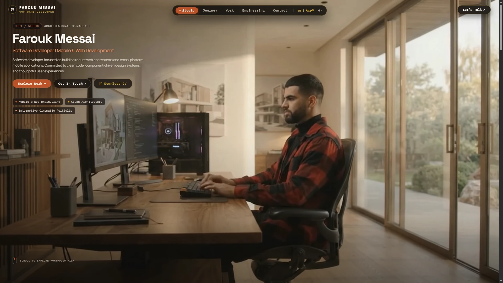
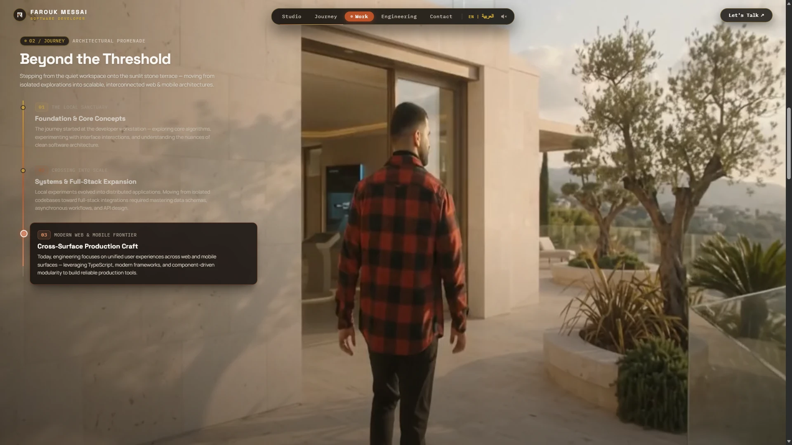
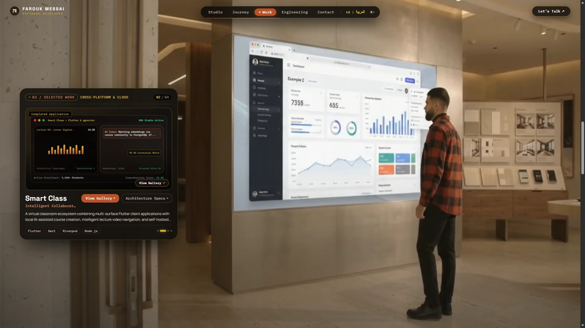
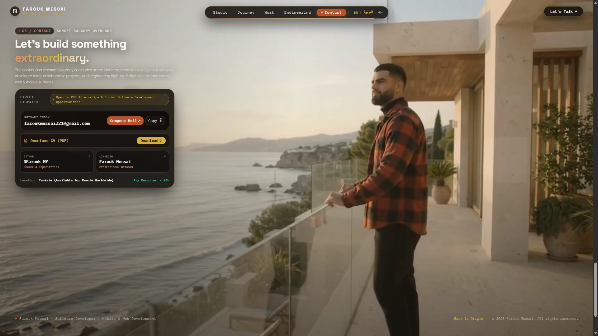
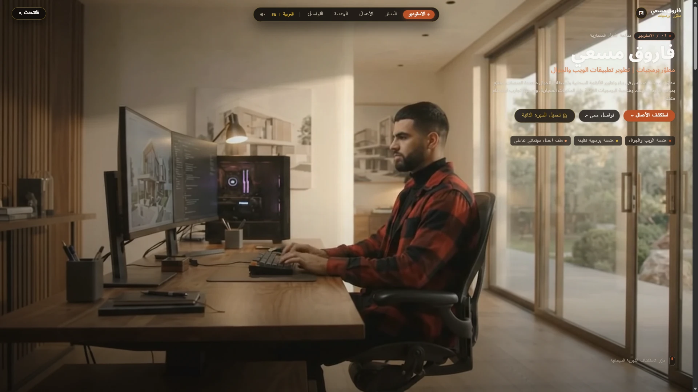
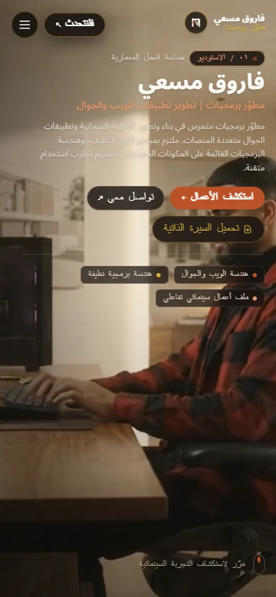

# FAROUK — BEYOND THE SCREEN
### An Interactive Cinematic Developer Portfolio

[](https://nextjs.org/)
[](https://react.dev/)
[](https://www.typescriptlang.org/)
[](https://tailwindcss.com/)
[](https://developer.mozilla.org/en-US/docs/Web/API/Web_Audio_API)
[](LICENSE)

**FAROUK — BEYOND THE SCREEN** is an interactive, scroll-orchestrated developer portfolio showcasing the engineering capabilities of **Farouk Messai** across mobile systems (React Native, Flutter) and modern web architectures (Next.js, TypeScript, FastAPI).

Departing from conventional static CV templates, the portfolio guides visitors through a continuous five-act Mediterranean architectural narrative. As visitors scroll, an authoritative 600svh runway synchronizes frame-accurate video seeking (`requestVideoFrameCallback` + coalesced seek queue) alongside an idle typing loop in Act I, revealing an interactive 3D-style project vitrine and deep architectural case studies.

---

## Experience Preview

### Desktop Experience (English & Arabic RTL)

| Act I: Studio (English) | Act II: Journey (English) |
| :---: | :---: |
|  |  |

| Act III: Selected Work (English) | Act V: Contact (English) |
| :---: | :---: |
|  |  |

| Arabic RTL Studio (Desktop) | Arabic RTL Mobile (390×844) |
| :---: | :---: |
|  |  |

---

## Core Features

- **Five-Act Cinematic Experience:** A continuous visual journey spanning Mediterranean architectural environments: Studio, Journey, Selected Work, Engineering, and Contact.
- **Scroll-Driven Video Synchronization:** 24 FPS frame-accurate video seeking powered by `requestVideoFrameCallback` and a coalesced seek queue. Includes a seamless idle typing loop handoff in Act I.
- **Dynamic 3D Project Exhibition:** Interactive vitrine wall in Act III that automatically cycles and scales across showcase projects without video stutter.
- **Architectural Project Case Studies:** In-depth technical drawers breaking down problem statements, engineering roles, system architectures, and tradeoff decisions with private repository integrity.
- **Complete Bilingual Support (EN / AR RTL):** Native routes for `/en` and `/ar` via Next.js 16 App Router. Modern Standard Arabic (الفصحى) with complete Right-to-Left (RTL) layout mirroring, logical properties, and directional asset flipping.
- **Local Arabic Typography:** Google's variable `Noto Sans Arabic` packaged locally via `next/font/local` (SIL OFL 1.1), integrated with Space Grotesk, Manrope, and IBM Plex Mono.
- **Procedural Web Audio Sound Engine:** 100% synthesized in real time via the native Web Audio API (0 KB external download). Tactile walnut mechanical clicks, harmonic chimes, and noise sweeps. **Sound is OFF by default** and requires explicit user opt-in.
- **Accessible Reduced-Motion Experience:** Automatic detection of `prefers-reduced-motion: reduce`, rendering a clean, multi-section semantic HTML portfolio with complete keyboard accessibility.
- **Localized Curriculum Vitae Integration:** Downloadable, pixel-perfect PDF resumes available directly in English (`/cv/farouk-messai-cv-en.pdf`) and Arabic (`/cv/farouk-messai-cv-ar.pdf`).

---

## The Five-Act Journey

```
[ Act I: Studio ] ──> [ Act II: Journey ] ──> [ Act III: Selected Work ] ──> [ Act IV: Engineering ] ──> [ Act V: Contact ]
```

1. **Act I — The Studio (`0.00 – 0.20`):** The developer's sunlit architectural workspace. Ambient typing idle loop that transitions smoothly into scrub mode upon scroll.
2. **Act II — The Journey (`0.20 – 0.40`):** Architectural promenade across the threshold. Visual metaphor for transitioning from local experiments to distributed production applications.
3. **Act III — Selected Work (`0.40 – 0.60`):** 3D curved exhibition wall showcasing flagship applications with synchronized hardware displays and architectural drawers.
4. **Act IV — Engineering (`0.60 – 0.80`):** Systems laboratory presenting core competencies across Mobile Engineering, Web Platforms, Clean Architecture, and Developer Tooling.
5. **Act V — Contact (`0.80 – 1.00`):** Sunset coastal balcony overlook providing direct mail dispatch, Tunisia location tag, availability badge, and CV downloads.

---

## Featured Projects

### 1. MediConnect
*Cross-Platform Telemedicine & Clinical Coordination System*
- **Stack:** React Native, Expo SDK 54, TypeScript, FastAPI (Python), WebRTC, Supabase / PostgreSQL.
- **Architecture:** Mobile client communicating via WebSocket and REST to an asynchronous FastAPI backend. Features real-time practitioner schedule resolution, peer-to-peer encrypted WebRTC video sessions, and QR check-in workflows.
- **Status:** Verified Architecture Prototype (Private Commercial Repository).

### 2. Smart Class
*Intelligent Collaborative Virtual Learning & Pedagogical Platform*
- **Stack:** Flutter, Dart, Riverpod, Node.js, Express, TypeScript, PostgreSQL 17, pgvector, Prisma ORM.
- **Architecture:** Virtual classroom ecosystem combining multi-surface Flutter client applications with Retrieval-Augmented Generation (RAG) through PostgreSQL pgvector for interactive AI tutoring and automated course structuring.
- **Status:** Architecture Prototype.

### 3. NEXFORM
*Interactive 3D Setup Studio & Product Customization Platform*
- **Stack:** Next.js (App Router), React 19, Three.js, React Three Fiber, TypeScript, Supabase, Tailwind CSS, Zustand, Zod.
- **Architecture:** Connected design-to-purchase 3D e-commerce platform. Features a browser-based dimensional room editor for assembling desks and peripherals, real-time material shader customization, and a PC hardware clearance validation engine.
- **Status:** Production Prototype.

### 4. LinguaMate
*Multilingual AI Companion & Interactive Language Learning App*
- **Stack:** Flutter, Dart, Riverpod, Supabase, GoRouter, Dio, Flutter TTS, Speech-to-Text.
- **Architecture:** Cross-platform conversational speech application combining real-time audio dialogue, pronunciation feedback scoring, and spaced-repetition vocabulary retention with offline storage caching.
- **Status:** Production Prototype.

---

## Technology Stack

| Domain | Technologies |
| :--- | :--- |
| **Framework** | [Next.js 16.4.4](https://nextjs.org/) (App Router, Turbopack, Partial Prerendering, Proxy convention) |
| **Runtime** | [React 19.3.0](https://react.dev/) + [TypeScript 5.x](https://www.typescriptlang.org/) (Strict Mode) |
| **Animation & Orchestration** | [GSAP 3.15](https://gsap.com/) + [ScrollTrigger](https://gsap.com/docs/v3/Plugins/ScrollTrigger/) + [@gsap/react](https://gsap.com/docs/v3/Plugins/useGSAP/) |
| **Smooth Scroll Engine** | [@studio-freight/lenis](https://lenis.darkroom.engineering/) (v1.3.27) synchronized with GSAP ticker |
| **Styling** | [Tailwind CSS v4](https://tailwindcss.com/) with CSS custom properties and logical directional utilities |
| **Typography** | Space Grotesk, Manrope, IBM Plex Mono, Google Noto Sans Arabic (Local Variable Font) |
| **Audio Engine** | Native Web Audio API (100% Procedural Synthesis, 0 KB Network Overhead) |
| **State & Localization** | React 19 Context (`LocaleContext`, `AudioContext`) with `localStorage` persistence |
| **CI / CD Automation** | GitHub Actions (`.github/workflows/ci.yml`) |

---

## Architecture Overview

```
+-----------------------------------------------------------------------------------------+
|                                  Next.js 16 App Router                                  |
|                                                                                         |
|   +-----------------------+     +-----------------------------+     +---------------+   |
|   |       proxy.ts        |     |   app/[lang]/layout.tsx     |     |  app/page.tsx |   |
|   |  (/ -> /en redirect)  |     |   (Font Loading, Metadata)  |     |  (Redirect)   |   |
|   +-----------------------+     +--------------+--------------+     +---------------+   |
|                                                |                                        |
+------------------------------------------------|----------------------------------------+
                                                 v
+-----------------------------------------------------------------------------------------+
|                                    Client Root Shell                                    |
|                                                                                         |
|   +--------------------+     +---------------------+     +--------------------------+   |
|   |   LocaleProvider   |     |    AudioProvider    |     |   SmoothScrollProvider   |   |
|   | (i18n & RTL State) |     | (Web Audio Engine)  |     |   (Lenis + GSAP Sync)    |   |
|   +---------+----------+     +----------+----------+     +------------+-------------+   |
|             |                           |                             |                 |
+-------------|---------------------------|-----------------------------|-----------------+
              v                           v                             v
+-----------------------------------------------------------------------------------------+
|                               Cinematic Page Experience                                 |
|                                                                                         |
|   +---------------------------------------+   +-------------------------------------+   |
|   |      CinematicVideoLayer (Canvas)     |   |       CinematicOverlay (DOM)        |   |
|   |  - 5-Act Frame-Accurate Scrubbing     |   |  - Decoupled Floating Header        |   |
|   |  - requestVideoFrameCallback          |   |  - 5 Synchronized Act Overlays      |   |
|   |  - Idle Typing Loop in Act I          |   |  - Architectural Case Study Modals  |   |
|   |  - Video Seek Coalescing Queue        |   |  - Language Switcher & Audio Toggle |   |
|   +---------------------------------------+   +-------------------------------------+   |
+-----------------------------------------------------------------------------------------+
```

---

## Getting Started

### Prerequisites
- Node.js 20.x or Node 24.x (CI verified on Node 24)
- npm 10.x or higher

### Installation
```bash
git clone https://github.com/Farouk-MY/Farouk-Beyond-the-Screen.git
cd Farouk-Beyond-the-Screen
npm ci
```

### Development Server
```bash
npm run dev
```
Open [http://localhost:3000](http://localhost:3000) to view the application (automatically redirects to `/en`).

---

## Quality Assurance & Verification

The project enforces strict verification gates before release:

```bash
# 1. Strict TypeScript compilation check
npx tsc --noEmit

# 2. Next.js 16 ESLint validation
npm run lint

# 3. Production Turbopack build
npm run build
```

---

## Author

**Farouk Messai**  
*Software Developer | Mobile & Web Development*  
- **Location:** Tunisia (Available for Remote Worldwide)  
- **Availability:** Open to PFE Internships & Junior Software Development Opportunities  
- **Email:** [faroukmessai221@gmail.com](mailto:faroukmessai221@gmail.com)  
- **GitHub:** [@Farouk-MY](https://github.com/Farouk-MY)  
- **LinkedIn:** [Farouk Messai](https://linkedin.com/in/faroukmessai)  

---

## License

This project is open-source software licensed under the [MIT License](LICENSE).  
Bespoke production footage and graphic assets are copyright © 2026 Farouk Messai.
